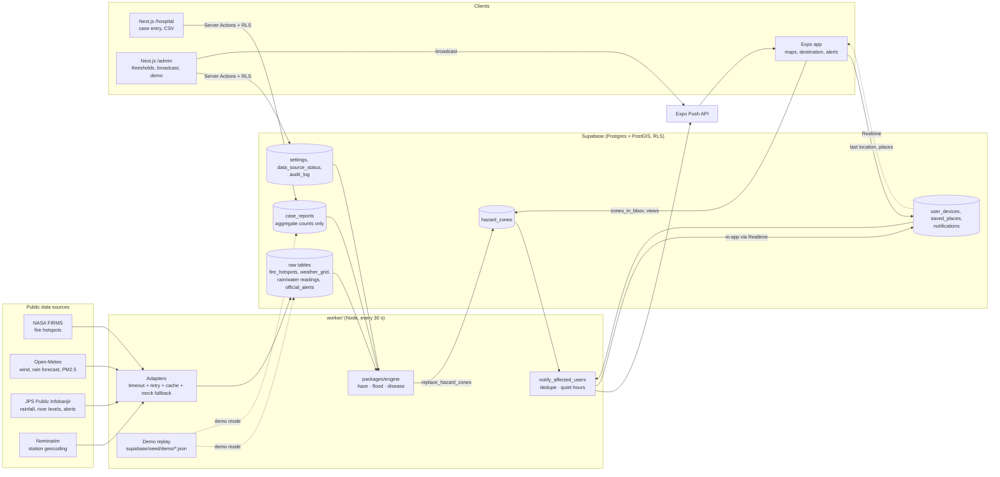

# JagaSekitar architecture

## Data flow

## Pieces

| Folder            | What it is                                                                                                                                                                    |
| ----------------- | ----------------------------------------------------------------------------------------------------------------------------------------------------------------------------- |
| `packages/shared` | Risk levels, colour/icon/label tokens, `HazardZone` type, zod schemas, Perak district list. Used by every other package.                                                      |
| `packages/engine` | Pure functions: haze plume model, flood rules, disease outbreak ratio, `assessPoint`, route risk. No I/O, so the app runs the same `assessPoint` on the phone. Vitest-tested. |
| `worker`          | Ingestion (adapters per source), the prediction job, the notification job, and demo replay. Runs as `npm run worker:dev` (30-second loop) or `worker:once`.                   |
| `supabase`        | Migrations (schema, RLS, views, RPCs), seed data, demo scenarios, and DB tests that run the real migrations on PGlite + PostGIS.                                              |
| `apps/mobile`     | Expo SDK 57 user app: main map, haze/flood/illness maps, destination check, places, alerts, settings, onboarding. EN/BM.                                                      |
| `apps/web`        | Next.js 16 portal: `/hospital` for staff, `/admin` for administrators. Supabase SSR auth, Server Actions, MapLibre maps.                                                      |

## Key decisions

- **Zones are the contract.** Every engine outputs `HazardZone` (hazard, level, geometry, validity window, confidence,
  bilingual reason). The app, notifications, destination check and admin preview all read zones; none of them know
  how a zone was computed. `replace_hazard_zones` swaps a hazard's zones in one transaction.
- **Time slices instead of animation data.** Haze zones are stored per forecast slice (now, +12, +24, +48, +72 h),
  each valid until the next. "Risk at arrival time" is just `assessPoint(lat, lon, zones, { time })`.
- **Every source can fail.** Adapters fall back from live → stale cache → `mock.json` (rebased to "now"), record the
  outcome in `data_source_status`, and never stop the run. JPS publishes no station coordinates, so locations are
  resolved from the JPS alert feed, Nominatim, the JPS station-number grid, then district centres, and admins can
  drag pins to fix them.
- **Security in depth.** RLS on every table (public hazard data; own devices/places/alerts; staff limited to their
  verified facility; admins all). The portal's proxy only redirects; every page and Server Action re-checks the role.
  Privileged operations are `security definer` RPCs that assert the caller's role. Audit triggers record changes with
  the acting user.
- **Privacy (PDPA).** Hospitals enter aggregate counts only (zod `.strict()` + a database CHECK rejects IC/phone
  numbers in notes). Devices store only the last known location. "Delete my data" removes devices, places and alerts.
- **Push without a build.** Expo Go on Android can't receive remote push, so the worker always writes the alert to
  `notifications`; the app listens over Realtime and shows a local notification. Devices with a push token (a
  development build) get real Expo push.
- **Demo mode is data, not a fork.** Scenarios write tagged rows into the same tables the live adapters use, so the
  engines, app and portal run unchanged. Stopping the demo deletes exactly the tagged rows and refreshes live data.
